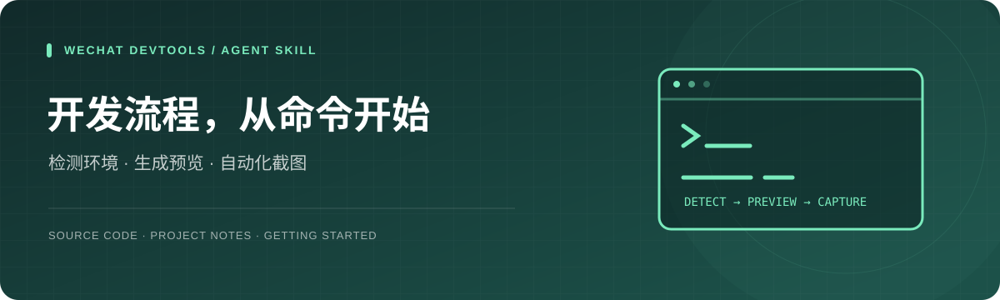
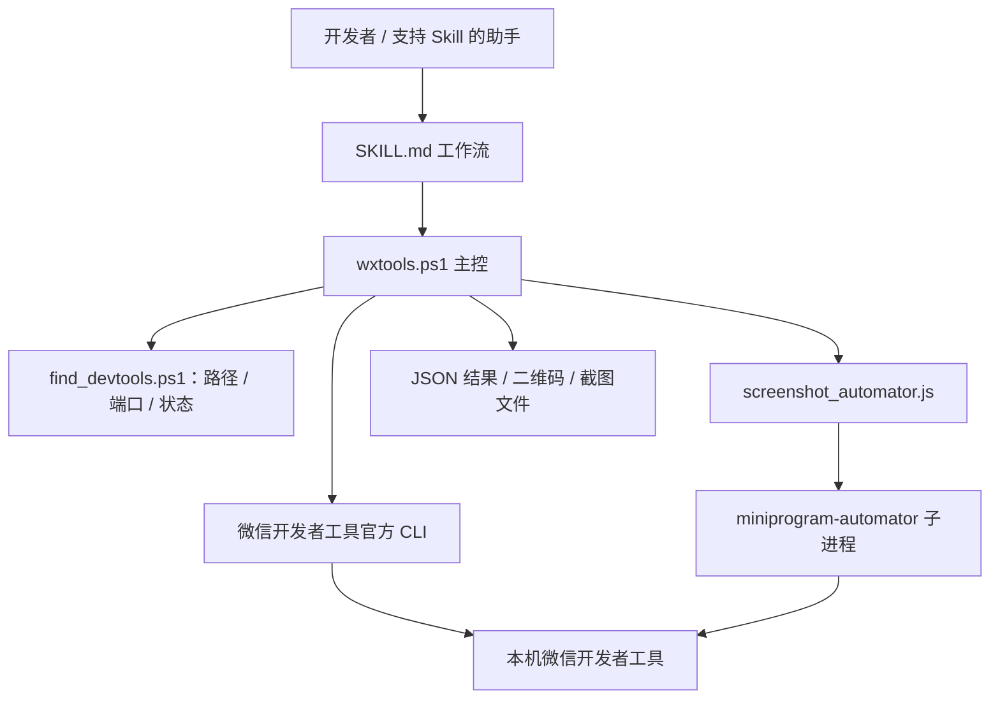

<div align="center">



# wechat-devtools

**把“打开工程、生成预览、查看模拟器”整理成可重复的命令工作流。**

微信开发者工具 Skill · Windows PowerShell · 官方 CLI 桥接 · JSON 结果


[](LICENSE)

[能做什么](#features) · [安装与开始](#quickstart) · [命令示例](#examples) · [架构](#architecture) · [排障与边界](#status)

</div>

## 为重复的小程序开发操作准备一个入口

这个仓库将微信开发者工具的常用操作整理成一个 Agent Skill 和一组本地脚本。先发现安装路径、端口与运行状态，再通过主控脚本打开项目、生成预览、构建 npm 或进入自动化截图流程。

它适合两种使用方式：**让支持 Skill 的助手按说明操作**，或**由开发者直接运行 PowerShell 命令**。工具链依赖本机微信开发者工具与微信登录状态，不提供云端代运行服务。

本仓库是一个独立的微信工具 Skill；不是微信官方产品，也不是包含所有微信开发技能的集合。

<a id="features"></a>
## 能做什么

| 能力 | 入口 | 说明 |
| --- | --- | --- |
| 环境发现 | `detect` | 检查 CLI 路径、端口、运行状态、Node 等信息 |
| 项目打开/关闭 | `open` / `close` | 通过开发者工具处理指定工程 |
| 真机预览 | `preview` | 支持终端二维码、图片或 base64 输出 |
| 自动预览 | `autopreview` | 需要开发者工具支持及相应白名单条件 |
| 依赖构建 | `build-npm` | 调用开发者工具的 npm 构建能力 |
| 缓存处理 | `clear-cache` | 按指定类型清理；执行前核对影响范围 |
| 自动化端口 | `start-auto` | 启动指定 Automator 端口，默认 9420 |
| 单页截图 | `screenshot` | 进入指定页面并保存 PNG；依赖自动化链路可用 |
| 多页截图 | `screenshot-all` | 遍历 `app.json` 中的 pages；需要逐页核对成功结果 |
| 状态汇总 | `status` | 汇总本地工具和依赖状态 |

**以上共 11 个子命令。** 主控脚本没有 `upload` 分发入口；虽然部分旧说明提到上传，发布上传需自行使用官方 CLI 或另行实现，不能用本仓库直接调用不存在的 `upload` 子命令。

## 为什么值得看

- **先检测再操作**：将常见的“没开服务端口”“路径不一致”“未运行”等问题前置。
- **同一个命令入口**：环境检测、工程管理、预览与截图脚本由 `wxtools.ps1` 组织。
- **结果便于程序读取**：封装层使用 JSON 表达成功状态、错误码、消息和建议；底层 CLI 自身可能另有日志或二维码输出。
- **保留人工可读说明**：[SKILL.md](SKILL.md) 描述工作流，两个参考文件补充 CLI 和 Automator 细节，方便继续维护。

<a id="quickstart"></a>
## 安装与开始

### 1. 前置条件

- Windows，PowerShell 5.1 或兼容环境。
- 已安装、启动并登录微信开发者工具。
- 在开发者工具的“设置 → 安全设置”开启服务端口。
- 截图工作流还需要 Node.js、npm / npx，以及可用的 `miniprogram-automator` 调用入口。
- 自己有权打开和预览的微信小程序工程。

### 2. 获取源码

```powershell
git clone https://github.com/zhen666555-sketch/wechat-devtools.git
Set-Location .\wechat-devtools
```

可以先从仓库直接运行，不必安装到 Skill 目录：

```powershell
powershell -NoProfile -ExecutionPolicy Bypass -File .\scripts\wxtools.ps1 -Help
powershell -NoProfile -ExecutionPolicy Bypass -File .\scripts\wxtools.ps1 detect
```

### 3. 可选：放入自己的 Skill 目录

把整个 `wechat-devtools` 目录放入自己的 Skill 安装目录，保留 `SKILL.md`、`scripts/`、`references/` 和 `agents/` 的相对结构。使用默认 Codex 目录时可参考：

```text
<用户目录>/.codex/skills/wechat-devtools/
├── SKILL.md
├── agents/openai.yaml
├── scripts/
└── references/
```

如果已经配置其他 Skill 根目录，使用自己的路径。以下示例采用仓库脚本路径，可按安装位置替换。

<a id="examples"></a>
## 常用命令示例

以下使用脚本实际声明的 **PowerShell 参数名**，例如 `-Project`、`-QrFormat`、`-OutputDir`。不要把底层 CLI 的 `--qr-format` 等写法直接当作主控脚本参数。

### 环境检测与打开项目

```powershell
$wxToolsPath = (Resolve-Path .\scripts\wxtools.ps1).Path
$miniProjectPath = 'E:\miniapp'

& $wxToolsPath detect
& $wxToolsPath open -Project $miniProjectPath
& $wxToolsPath status
```

自动发现失败时，可手动提供本机 CLI 与 HTTP 端口：

```powershell
& $wxToolsPath detect -CliPath 'C:\WeChatDevTools\cli.bat' -Port 27462
```

这里的路径与端口仅为示例。**HTTP 服务端口与 Automator 端口是两个不同用途的端口**，不能混用。

### 生成预览二维码

```powershell
# 在终端显示
& $wxToolsPath preview -Project $miniProjectPath -QrFormat terminal

# 保存二维码图片
& $wxToolsPath preview -Project $miniProjectPath `
  -QrFormat image -QrOutput '.\qr.png'

# 输出 base64 形式
& $wxToolsPath preview -Project $miniProjectPath -QrFormat base64
```

### 构建依赖与处理缓存

```powershell
& $wxToolsPath build-npm -Project $miniProjectPath
& $wxToolsPath clear-cache -Project $miniProjectPath -CacheType compile
```

只在工程需要 npm 构建时执行对应命令。清缓存时先选择具体类型；`all`、`storage`、`auth` 等可能影响本地业务数据或登录状态。

### 截图工作流

```powershell
& $wxToolsPath start-auto -Project $miniProjectPath -AutoPort 9420

& $wxToolsPath screenshot -Project $miniProjectPath `
  -Page '/pages/index/index' -Output '.\screenshots\home.png' -Wait 2500

& $wxToolsPath screenshot-all -Project $miniProjectPath `
  -OutputDir '.\screenshots' -Wait 2500
```

**截图链路需按本机工具版本验证。** 当前截图脚本通过子进程调用 `npx -y miniprogram-automator -e ...`，其可执行入口与参数是否被安装版本支持，需要运行前核对；安装 SDK 不代表该调用方式必然可用。页面参数、登录态和渲染等待也可能影响结果。

`screenshot-all` 当前按 `app.json` 的 `pages` 遍历，不等于覆盖分包、动态路径、所有参数和交互状态。脚本会开启/关闭自动化会话，使用前保存正在调试的工作。

## 输出约定

错误对象采用如下形状，错误码和提示依实际分支而定：

```json
{
  "success": false,
  "errorCode": "ERR_EXAMPLE",
  "errorMessage": "示例错误消息",
  "hints": ["检查对应的工具、端口或项目配置"]
}
```

批量截图还会返回每页结果及成功/失败数量。自动化消费者应同时检查退出码、`success` 和实际文件，不能只把某一行日志当作截图成功证明。

<a id="architecture"></a>
## 工作原理与目录



```text
wechat-devtools/
├── SKILL.md                      # Skill 触发说明与操作工作流
├── agents/openai.yaml            # Agent 展示配置
├── scripts/
│   ├── find_devtools.ps1         # 环境检测
│   ├── wxtools.ps1               # 11 个子命令
│   └── screenshot_automator.js   # 截图子进程封装
├── references/
│   ├── cli-reference.md         # CLI 参考
│   └── automator-reference.md   # 自动化参考
└── LICENSE
```

截图产物可以交给具备图像能力的助手或其他工具继续分析。仓库中关于临时目录和 JSON 交接的说明属于协作约定，不是已验证的跨 Agent 自动调度服务。

<a id="status"></a>
## 排障与当前边界

| 现象 | 优先检查 |
| --- | --- |
| 找不到开发者工具 | CLI 安装路径，必要时传 `-CliPath` |
| 端口不通 | 工具是否启动、服务端口是否开启，HTTP 端口是否正确 |
| 预览失败 | 微信登录、AppID 权限、工程编译错误和官方 CLI 输出 |
| 参数未绑定 | 用 `-Project` 等 PowerShell 参数；以脚本 param 块为准 |
| 截图提示找不到命令 | Node/npm/npx 及 Automator 可执行入口兼容性 |
| 截图空白或页面失败 | 页面路径、查询参数、登录态、接口和等待时长 |
| 批量截图遗漏页面 | 当前只遍历主包 pages，需另行处理分包与状态 |

当前代码与历史说明存在一些版本性差异，使用时优先核对脚本真实参数和分发器。仓库没有完整跨版本端到端验证矩阵，不将“脚本入口存在”写成所有微信开发者工具版本均已通过验收。

## 继续完善

- [ ] 更新历史 Skill 示例，使参数与当前 PowerShell 声明一致。
- [ ] 验证并完善 Automator 的依赖安装、调用入口与会话复用。
- [ ] 扩展分包、页面参数、登录前置和失败重试配置。
- [ ] 完善并发运行时临时文件隔离与日志输出约定。
- [ ] 建立工具版本、PowerShell 版本和操作系统的兼容性记录。

## 参考、反馈与许可

- [官方 CLI 文档](https://developers.weixin.qq.com/miniprogram/dev/devtools/cli.html)
- [官方 HTTP API](https://developers.weixin.qq.com/miniprogram/dev/devtools/http.html)
- [官方 Automator 文档](https://developers.weixin.qq.com/miniprogram/dev/devtools/auto/automator.html)
- [本仓库 CLI 参考](references/cli-reference.md) · [Automator 参考](references/automator-reference.md)
- [提交问题](https://github.com/zhen666555-sketch/wechat-devtools/issues)：附工具版本、命令、预期结果和脱敏日志。

根目录许可证为 [Apache License 2.0](LICENSE)。微信开发者工具与第三方 SDK 的使用同时遵守其各自条款。
